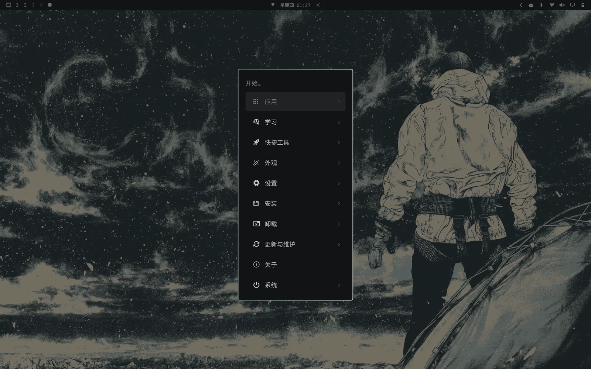
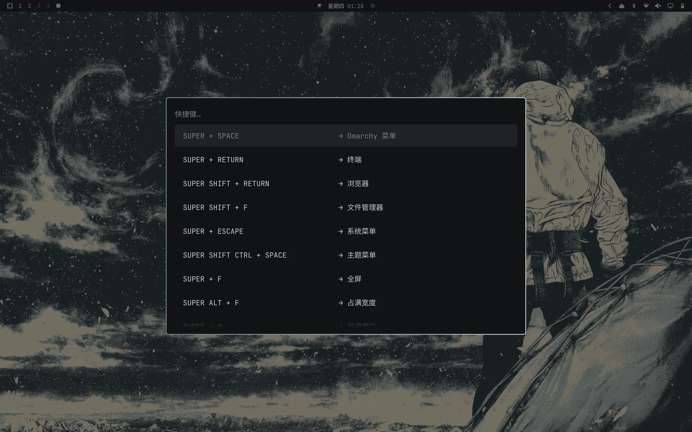
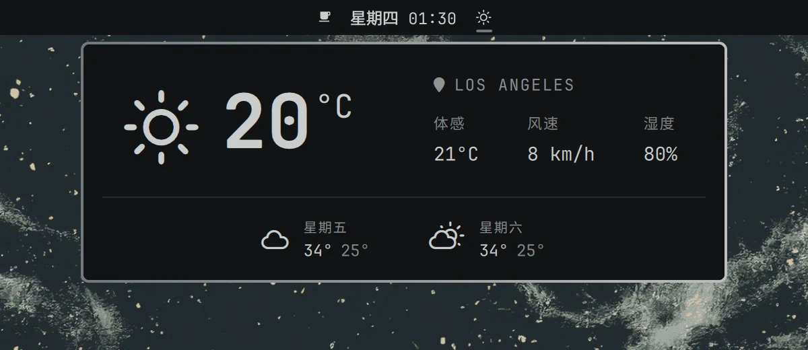
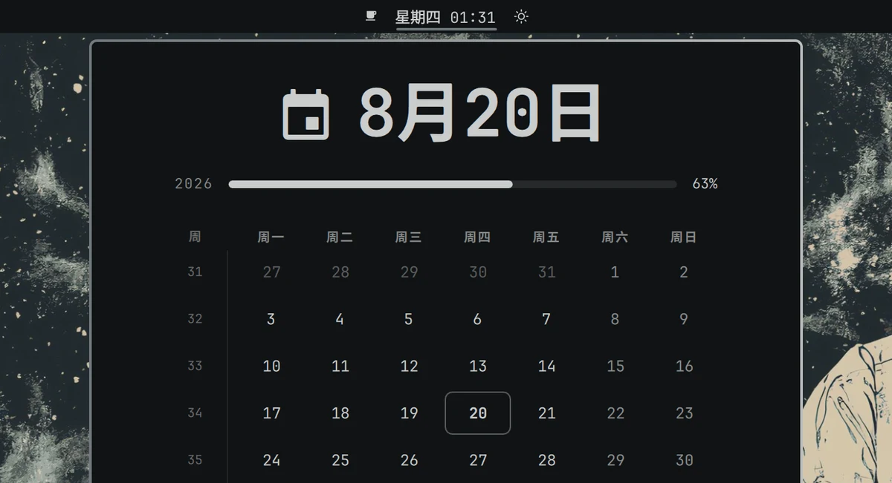
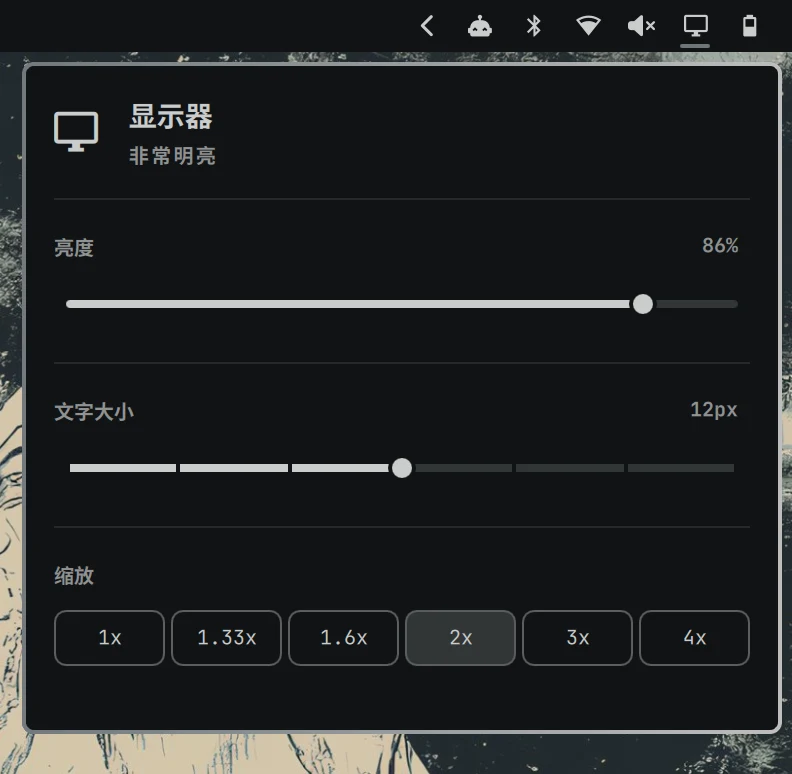
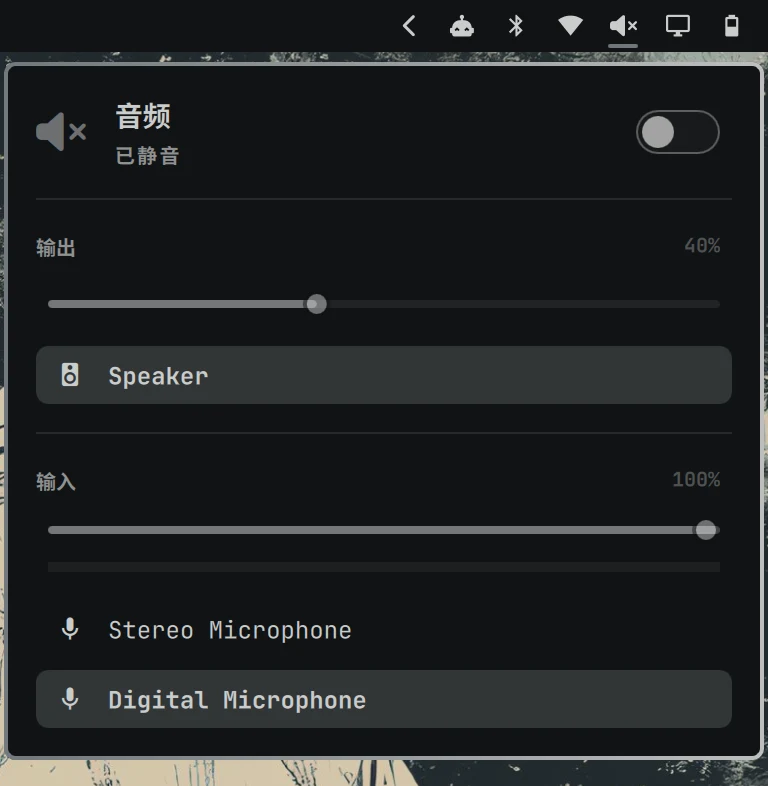
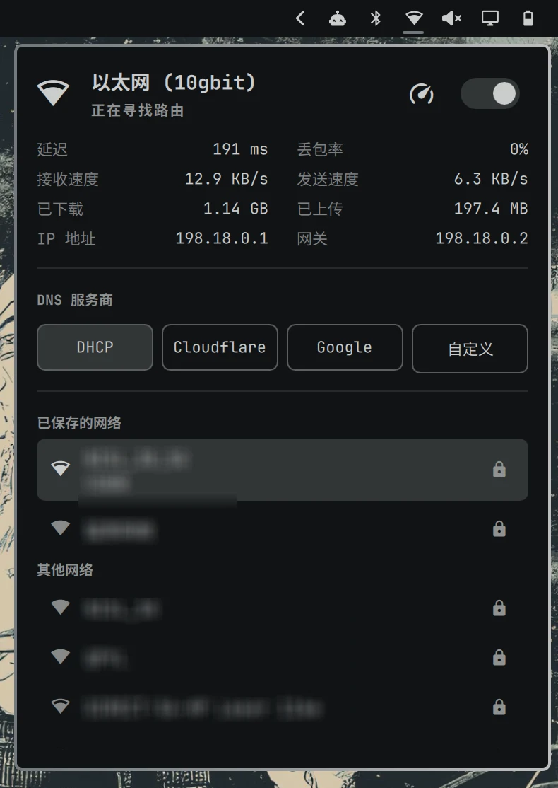
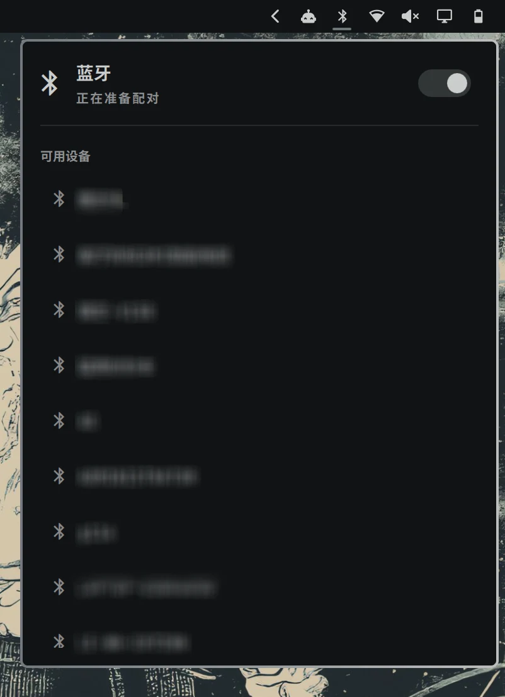
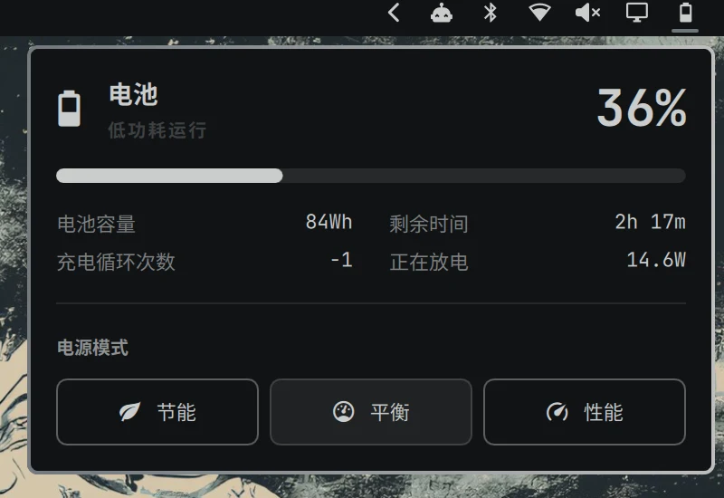

# Omarchy Simplified Chinese Localization

[简体中文](README.md) | **English**

An unofficial Simplified Chinese localization project for Omarchy 4. It generates user-scoped plugin clones from the Omarchy sources currently installed on the machine. It never modifies `/usr/share/omarchy` and does not redistribute Omarchy plugin source code in this repository.

## Preview

These screenshots were captured on an Omarchy 4 desktop with this project installed. Wallpapers, themes, and weather data will vary by environment.

### Chinese Main Menu



### Chinese Keyboard Shortcuts Panel



### Weather and Date

| Celsius, `km/h`, and Chinese weather fields | Chinese dates, months, and weekdays |
| --- | --- |
|  |  |

### Common System Panels

| Display and scaling | Audio input and output |
| --- | --- |
|  |  |

| Network and DNS | Bluetooth devices |
| --- | --- |
|  |  |

### Power and Performance Profiles



### AI Agent Usage Bar

This project extends the upstream Agents widget with Grok Build and Kimi Code, and adds a compatibility fix for the approval policy used by newer Codex CLI releases. Grok and Kimi marks switch between light and dark variants with the active Omarchy theme. Providers without a valid login or usable data remain hidden.

| Provider | Usage source | How to enable |
| --- | --- | --- |
| Codex | Codex app-server and local sessions | Sign in with Codex CLI; the compatibility scripts never copy tokens |
| Grok | Grok Build account limits and balance endpoint | Run `grok login` |
| Kimi | Kimi Coding Plan weekly quota and five-hour window | Set `KIMI_API_KEY` or use a mode-`0600` settings file |

Kimi settings live at `~/.config/omarchy/agents/kimi.json`:

```json
{
  "apiKey": "your API key",
  "region": "cn"
}
```

`region` may be `cn` (`api.kimi.com`) or `global` (`api.kimi.ai`). The collector can also discover a future Kimi Code CLI login under `~/.kimi-code/`. Credentials are used only for quota requests and are never written to the usage JSON consumed by the widget.

## Localized Content

- The Omarchy main menu and more than 300 menu items
- The status bar, plugin settings, and common panels
- Grok and Kimi support in the AI Agents usage widget, including quota displays and theme-aware light/dark marks
- Compatibility for the `initialize` failure caused when a newer Codex CLI rejects the legacy `untrusted` approval policy
- Audio, Bluetooth, network, display, power, and weather interfaces
- Dates, months, weekdays, and the calendar
- Celsius temperatures, `km/h` wind speeds, and original location names from the data source
- Reminders, notification history, and Omarchy activity notifications
- System tray, clipboard, emoji and image pickers, speed tests, and Wi-Fi QR codes
- Chinese emoji search keywords when a local Fcitx 5/Rime emoji annotation file is available
- Lock screen, authentication, and Omarchy-controlled snapshot, package, migration, error, and restart messages during updates
- The `Super + K` keyboard shortcuts panel and command descriptions
- Automatic resynchronization after Omarchy updates

Proper names, commands, actual file paths, and third-party application content are not forcibly translated. Examples include Omarchy, Hyprland, Codex, DNS, Docker, and `Downloads`.

## Compatibility

- Omarchy `4.x`
- Node.js, jq, and gum, all included in a standard Omarchy 4 environment
- A running Omarchy Shell session

This project generates localized clones against the plugin structure installed on the system. When an Omarchy update changes the interface source, the synchronizer regenerates those plugins. If an upstream change is incompatible, synchronization fails explicitly and preserves the last working version.

## Installation

### Install with an AI Assistant

If your AI assistant can read local files and run terminal commands, send it the complete prompt below:

```text
Please install this Simplified Chinese localization project on the current Omarchy 4 system:
https://github.com/QueedWen/omarchy-zh-cn

Requirements:
1. Read README.md, README.en.md, and install.sh first, then check whether the current system, Omarchy version, and dependencies are compatible.
2. Clone the repository into a suitable user directory. If the target directory already exists, do not overwrite it; inspect its current state first.
3. Run ./install.sh --dry-run first. Run ./install.sh only if the dry run succeeds.
4. Do not modify /usr/share/omarchy, overwrite existing user plugins, or overwrite personal configuration.
5. If same-name plugin clones or any other conflicts are found, stop and explain the exact conflict. Do not use --adopt-existing without my explicit approval.
6. Ask for my explicit approval before any operation that requires a password, privilege elevation, or overwriting files.
7. After installation, run the project tests, check the synchronization result and Hyprland configuration errors, then report which locations changed, the test results, and how to uninstall the project.
```

### Manual Installation

```bash
git clone https://github.com/QueedWen/omarchy-zh-cn.git
cd omarchy-zh-cn
./install.sh --dry-run
./install.sh
```

The installer will:

1. Check the Omarchy version and dependencies.
2. Create 26 user plugin clones through the official `omarchy plugin clone` command.
3. Install the localization synchronizer and generate the localized plugins.
4. Install the Codex/Grok/Kimi usage extension and theme marks for the Agents plugin.
5. Configure metric units for weather data.
6. Map `Super + K` to the Chinese keyboard shortcuts panel.
7. Generate localized update scripts from the currently installed version and route the Omarchy menu and status-bar update actions through them.
8. Install a `post-update` hook that automatically resynchronizes after Omarchy updates.

If clones with the same username and plugin suffix already exist, the installer stops to avoid overwriting personal modifications. Use the following command only after confirming that those clones were created by an earlier version of this localization:

```bash
./install.sh --adopt-existing
```

## Manual Synchronization

```bash
omarchy-zh-sync
```

Available options:

```text
--quiet           Only print output on failure
--no-restart      Do not restart Omarchy Shell after synchronization
--adopt-existing  Adopt existing clones whose source matches
```

## Chinese Locale and Input Methods

The installer does not change the system locale or install system packages. For a Chinese system locale, fonts, or the Fcitx 5/Rime input method, see the [Chinese system environment and input method guide](docs/system-setup.md) (Chinese).

## Uninstallation

```bash
./uninstall.sh
```

The uninstaller restores the pre-installation menu and update command, removes plugin clones managed by this project, and restores the previous `Super + K` configuration. The Omarchy plugin removal command and this uninstaller both retain timestamped backups instead of immediately destroying user configuration.

## Modification Scope

The project writes only to the following user directories:

```text
~/.config/omarchy/plugins/
~/.config/omarchy/extensions/omarchy-menu.jsonc
~/.config/omarchy/hooks/post-update.d/
~/.config/omarchy/shell.json
~/.config/hypr/bindings.lua
~/.local/bin/
~/.local/share/omarchy-zh-cn/
~/.local/state/omarchy-zh-cn/
```

`/usr/share/omarchy` always remains read-only. The installer does not collect or upload notification history, network information, location data, tokens, or other user data.

## Development and Checks

```bash
./tests/smoke.sh
```

On an Omarchy system, the tests also generate an isolated copy from the currently installed system plugins under a temporary `HOME`; they do not touch the real user configuration.

Read [CONTRIBUTING.md](CONTRIBUTING.md) before contributing translations.

## Other Language Versions

- [Traditional Chinese (Taiwan) — omarchy-zh-tw](https://github.com/Vik1n9/omarchy-zh-tw): A community derivative maintained by [Vik1n9](https://github.com/Vik1n9), based on this project and adapted for Taiwanese terminology, the `zh_TW` locale, and local date formats. Thanks to the author for the translation and contribution.

## Disclaimer

This is a community project and is not affiliated with the official Omarchy project. Omarchy and its source code are governed by their upstream licenses. This repository contains only the installation logic, synchronization logic, and Chinese translations written for this project, and is licensed under the MIT License.
